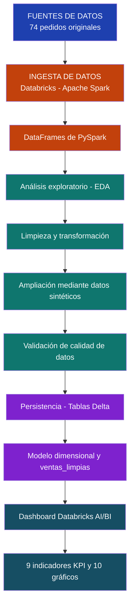

# Diagrama de arquitectura Big Data - NANOPARURO

## Descripción

La arquitectura representa el flujo de procesamiento de
los datos comerciales de NANOPARURO, desde la ingesta
hasta la generación de indicadores y visualizaciones
para la toma de decisiones.
